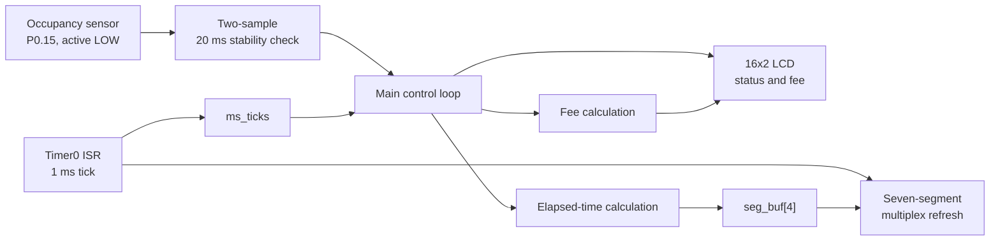
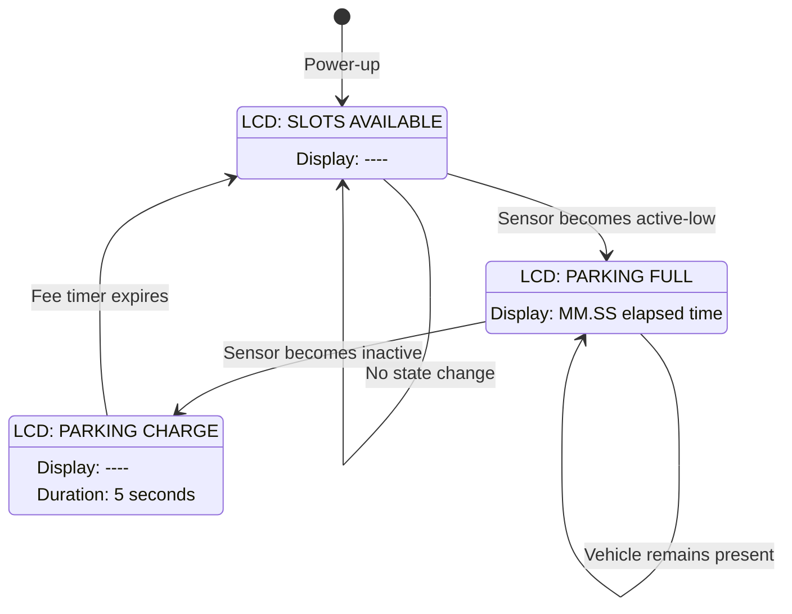
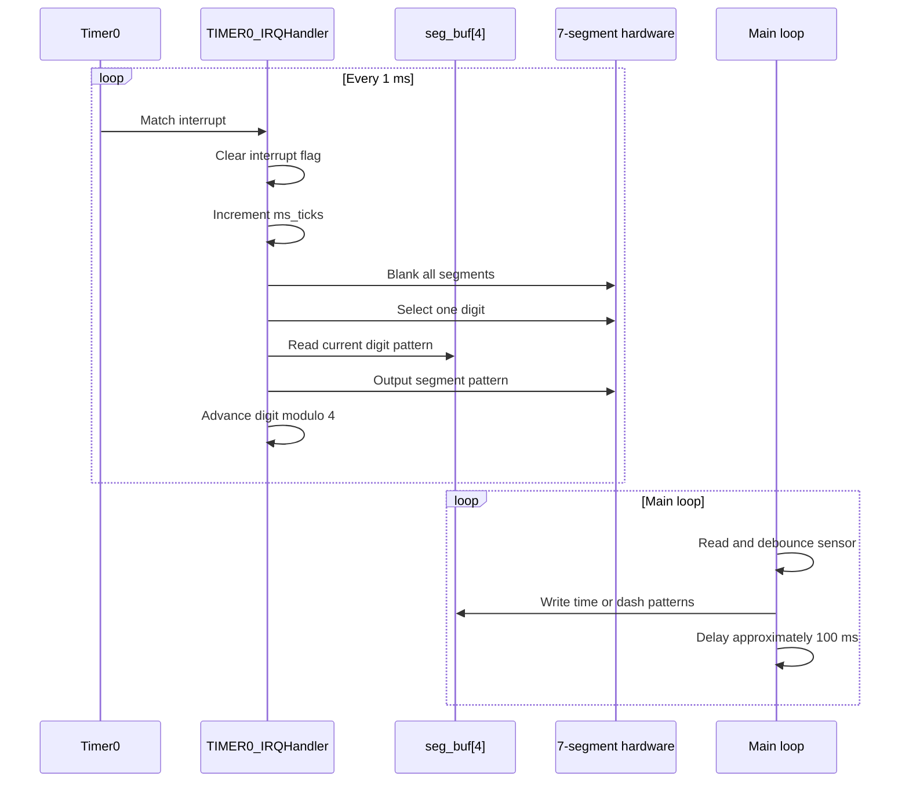
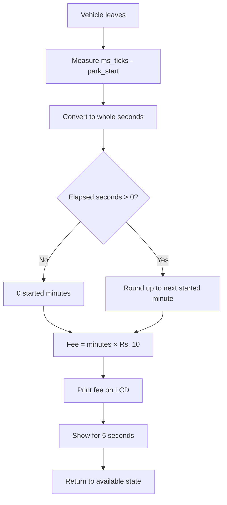

# Smart Parking System

Embedded firmware for a **single-slot smart parking meter** built on an
**NXP LPC1768** development board. The firmware detects whether a vehicle is
present, shows the current parking duration on a four-digit seven-segment
display, and calculates a parking fee when the vehicle leaves.

The implementation is intentionally small and hardware-oriented: all
peripheral access is performed through the LPC17xx register interface, with no
RTOS or dynamic memory allocation.

## Features

- Single parking-slot occupancy detection using an active-low sensor
- Two-sample, 20 ms stability check to suppress sensor bounce/noise
- Four-digit multiplexed seven-segment display
- Elapsed parking time displayed as `MM.SS`
- Parking duration capped at `99:59` on the seven-segment display
- Fee calculation at **Rs. 10 per started minute**
- Fee shown on the 16×2 LCD for five seconds after vehicle departure
- Timer0 interrupt that refreshes the display at 250 Hz per digit
- LCD messages for available, occupied, and recently vacated states

## Hardware

| Component | LPC1768 connection | Purpose |
|---|---|---|
| LCD D4–D7 | P0.23–P0.26 | 4-bit LCD data bus |
| LCD RS | P0.27 | Register select |
| LCD EN | P0.28 | Enable/latch |
| Seven-segment segments `a..g,dp` | P0.4–P0.11 | Segment data |
| Seven-segment digit select | P1.23–P1.26 | BCD input to 74LS145 |
| Occupancy sensor OUT | P0.15 | Active-low vehicle detection |
| Sensor VCC/GND | TP2 / TP3 | 3.3 V power and ground |
| LCD contrast | POT3 | Contrast adjustment |

The board and connector arrangement assumed by the source file is:

```text
CND -> CNAD (FRC)   LCD
CNA -> CNA2 (FRC)   Seven-segment segment data
CNB -> CNB2 (FRC)   Seven-segment digit-select BCD
CNC pin 1           Occupancy sensor output
```

## System Overview



The main loop owns application state and LCD updates. Timer0 runs
independently, even while the main loop is inside the busy-wait
`delay_ms()` function, so the display remains refreshed without visible
flicker.

## Runtime State Machine

The firmware uses the sensor transition as the event boundary for a parking
session:



### State behavior

1. **Available**
   - LCD shows `SLOTS AVAILABLE` and `SLOTS: 1/1 FREE`.
   - The seven-segment display shows four dashes.
   - No fee is charged at startup.
2. **Occupied**
   - A new session records `park_start = ms_ticks`.
   - LCD shows `PARKING FULL` and `SLOTS: 0/1 FREE`.
   - The seven-segment display continuously shows elapsed time as `MM.SS`.
3. **Fee window**
   - On departure, elapsed seconds are converted to started minutes.
   - The calculated fee is printed on the LCD.
   - The seven-segment display returns to dashes.
   - After five seconds, the LCD returns to the available state.

## Timing and Display Refresh

Timer0 is configured for a 1 ms match interrupt:



Each interrupt drives one of four digits, so every digit is revisited every
4 ms, producing an effective refresh rate of approximately **250 Hz per
digit**. The ISR blanks the segment bus before selecting the next digit to
reduce ghosting.

## Parking Fee Calculation

The configured rate is:

```c
#define FEE_PER_MINUTE 10u
```

The firmware bills every started minute, rather than rounding down:

```text
parked_seconds = elapsed milliseconds / 1000
parked_minutes = (parked_seconds + 59) / 60
parking_fee     = parked_minutes * FEE_PER_MINUTE
```



Examples:

| Parking duration | Billed minutes | Fee |
|---:|---:|---:|
| 0 seconds | 0 | Rs. 0 |
| 1–60 seconds | 1 | Rs. 10 |
| 61–120 seconds | 2 | Rs. 20 |
| 121–180 seconds | 3 | Rs. 30 |

## Source Layout

| Function or symbol | Responsibility |
|---|---|
| `TIMER0_IRQHandler()` | Maintains the millisecond clock and multiplexes one display digit |
| `seg_init()` | Configures seven-segment GPIO and Timer0 |
| `seg_show_time()` | Converts seconds to `MM.SS` segment patterns |
| `seg_show_dashes()` | Clears the time display using dash patterns |
| `lcd_init()` | Initializes the LCD in 4-bit mode |
| `lcd_cmd()` / `lcd_data()` | Sends LCD commands and characters |
| `lcd_print()` | Writes a null-terminated string to the LCD |
| `slot_occupied()` | Reads the active-low sensor and waits for two matching samples |
| `main()` | Initializes hardware, detects state transitions, and coordinates status/fee behavior |
| `seg_buf[4]` | Volatile display buffer shared by the main loop and Timer0 ISR |
| `ms_ticks` | Volatile millisecond counter shared by the main loop and Timer0 ISR |

## Build Assumptions

The source is intended for an LPC1768 project configured with:

- The LPC17xx CMSIS/device headers, including `LPC17xx.h`
- A startup file that defines `SystemInit()`
- A linker script and startup code that provide `SystemCoreClock`
- An interrupt vector table mapping `TIMER0_IRQHandler` to `TIMER0_IRQn`
- A clock configuration where the `delay_ms()` calibration is approximately
  correct for 100 MHz

Add [`parking_v2_with_parking_fee.c`](C:/Users/marsh/Downloads/parking_v2_with_parking_fee.c)
to the board project and build it with the vendor/CMSIS support package for
the target board. The exact compiler flags and linker settings depend on the
IDE and board project template, so they are not embedded in this standalone
source file.

## Configuration

The most relevant compile-time settings are:

| Macro | Default | Description |
|---|---:|---|
| `FEE_PER_MINUTE` | `10u` | Charge per started minute |
| `FEE_DISPLAY_MS` | `5000u` | Duration of the LCD fee screen |
| `SEG_REVERSED` | `1` | Reverses logical-to-physical digit order |

If the digits appear in the wrong order, change `SEG_REVERSED` to `0`.
If the display is wired with a different segment polarity or bit order, the
`seg_digit[]`, `SEG_DASH`, and `SEG_DP` patterns must be adapted to the
hardware.

## Important Design Notes

- `ms_ticks` and `seg_buf` are `volatile` because they are shared with the
  Timer0 interrupt handler.
- The signed comparison used for the fee timeout is intended to remain valid
  across a 32-bit millisecond-counter wrap, provided comparisons occur within
  the usual half-range of the counter.
- The sensor is sampled twice with a 20 ms delay and accepted only when both
  readings agree. This is a simple debounce/filter, not a configurable
  hardware-level debounce circuit.
- The LCD fee is rendered as decimal text using a small local character
  buffer; the seven-segment display is used only for time and dashes.
- `delay_ms()` is a calibrated busy wait. Its accuracy depends on the clock
  frequency and compiler optimization settings.

## Limitations and Extension Ideas

Current behavior is intentionally limited to one slot and one active session.
Potential extensions include:

- Supporting multiple sensors and multiple slot states
- Persisting transactions or fees to non-volatile storage
- Adding an RTC for wall-clock timestamps
- Replacing the calibrated busy wait with a timer-based delay
- Adding sensor fault detection and timeout handling
- Showing the fee on the seven-segment display when the LCD is unavailable
- Moving LCD writes to a non-blocking state machine

